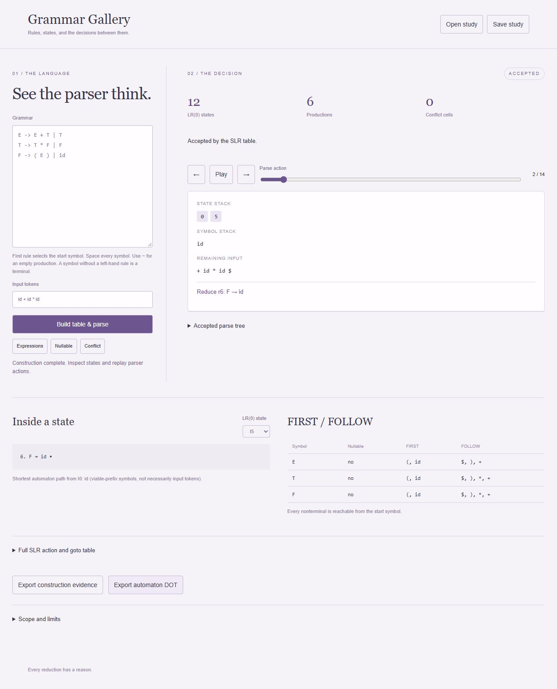

# Grammar Gallery

A compact compiler workbench that constructs canonical LR(0) item sets, computes nullable/FIRST/FOLLOW information, builds an SLR(1) table, and replays deterministic shift/reduce parsing. Conflict cells link to the item sets that explain them.



## Run

```sh
python run.py --port 8000
```

Open http://127.0.0.1:8000. Python 3.10+ serves static assets; computation runs in a browser module worker. Node 22+ runs the dependency-free tests. There are no runtime packages or network uploads.

## Grammar notation

```text
E -> E + T | T
T -> T * F | F
F -> ( E ) | id
```

Use a rule per line, with `|` alternatives and whitespace between symbols. The first left-hand symbol is the start symbol. A symbol occurring on a left-hand side is a nonterminal; every other RHS symbol is a terminal, even when it begins with an uppercase letter. `~` alone means epsilon. Empty alternatives are rejected to catch accidental omissions. `$` is reserved for automatically appended EOF, and `@` names the internal augmented start symbol.

Nonterminal names start with an uppercase ASCII letter and contain up to 16 letters/digits/underscores. Terminals are short ASCII tokens using the validator's documented character class in `core.js`; whitespace and `|` cannot be literal token characters. Input is already tokenized by whitespace: `id + id` is three tokens, while `id+id` is one unknown token. This app does not lex source code.

The expression example has six original productions, 12 states, 22 transitions, and no SLR conflicts. Input `id + id * id` accepts in 14 recorded parser actions; the tree places multiplication inside the right-hand term. The Nullable preset supports `a* b*` and empty input. The Conflict preset intentionally omits expression precedence.

## Inspect and export

Scrub or play the parser trace to inspect the state stack, symbol stack, remaining input, and current action. The state inspector follows the trace's stack top; its dropdown, transition buttons, table rows, and conflict buttons also support direct inspection. FIRST excludes epsilon, which has a separate nullable column. FOLLOW may include EOF.

The shortest path to an item set is an automaton path over grammar symbols—a viable prefix, potentially containing nonterminals. It is not claimed to be a shortest accepted input or an ambiguity witness. Unreachable nonterminals are reported separately.

Save/open JSON studies containing exactly `grammar` and `input` strings. Save study captures the current draft fields. Editing disables evidence exports until rebuilt. Evidence includes productions, item sets, transitions, sets, action/goto tables, conflicts, parse trace, accepted tree, and inspection position. DOT exports the item automaton with full item labels for external Graphviz rendering.

## Construction

Nullable and FIRST sets reach a fixed point, followed by FOLLOW propagation through nullable suffixes. LR(0) closure expands items whose next symbol is a nonterminal. Canonical states are deduplicated sorted item sets, discovered breadth-first over sorted outgoing symbols. Terminal transitions create shifts; nonterminal transitions create gotos. Completed original productions reduce on the LHS FOLLOW set; the completed augmented production accepts on EOF.

Action cells retain every distinct action. Any multi-action cell blocks deterministic parsing globally, even if a particular input would not reach it. No arbitrary shift preference or precedence override is applied. A conflict proves the grammar is not SLR(1), **not that it is ambiguous**: more precise LR methods can handle some grammars rejected by SLR. The test suite includes such a standard assignment grammar.

On a conflict-free table, shifts consume input and reductions replace RHS symbols with a constructed LHS tree node. Rejection reports the current token and table's valid lookaheads. Trace snapshots describe state before the recorded action. Prototype-named terminals such as `__proto__` are treated as ordinary keys rather than JavaScript object metadata.

## Limits and scope

Grammar text: 8,000 characters; 24 original productions; 12 nonterminals; 20 terminals; eight symbols per RHS; 80 item states. Input: 4,000 characters and 100 tokens. Parser: 500 actions, reported as a limit if reached. Study files: 50 KB. Empty source grammar is invalid; empty input is valid when generated by the grammar. Duplicate productions are rejected.

There are no lexer rules, semantic actions, precedence declarations, error recovery, parser code generation, or LR(1)/LALR construction. The app is an inspectable bounded teaching tool rather than a production parser generator.

## Verification

```sh
npm test
npm run check
python -m unittest discover -s tests -v
```

Seven JavaScript tests cover expression precedence, nullable chains, shift/reduce and reduce/reduce conflicts, a non-SLR assignment grammar, prototype-named tokens, item closures/transitions, validation, and all terminal strings through length six against independent bounded derivation enumeration for four grammars. Accepted trees must reproduce their input leaves. A Python test checks static asset restrictions, Host validation, and HEAD responses. CI runs Node 22/24 on Linux and Node 24 on Windows.

Browser checks covered trace navigation, accepted trees, conflict inspection, empty-input acceptance, invalid token order, and exports. Independent Python construction verified the example's 12 item sets, 22 transitions, FIRST/FOLLOW sets, all 14 parser actions, tree rules, and DOT edges.

Background: Cornell's [bottom-up parsing notes](https://courses.cs.cornell.edu/courses/cs4120/2026sp/notes.html?id=bottomup) explain the SLR refinement of LR(0). [Example study](docs/example.json).
